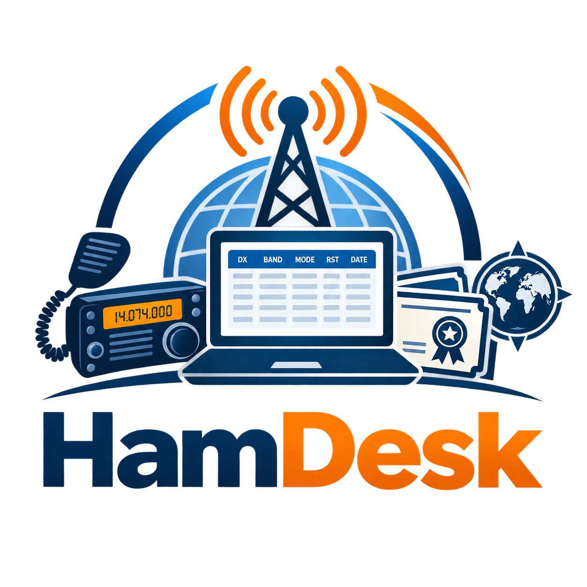
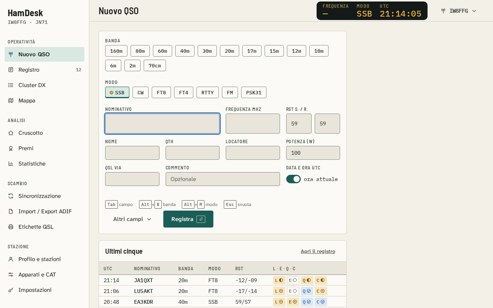
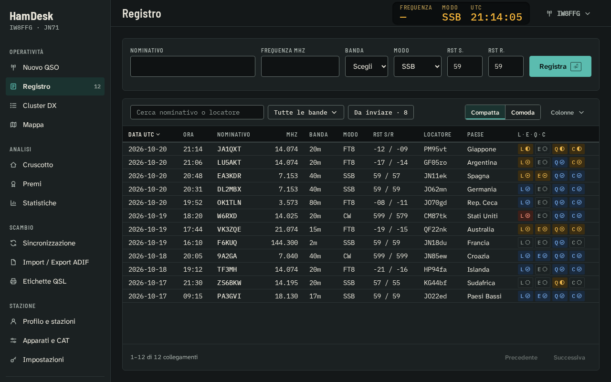
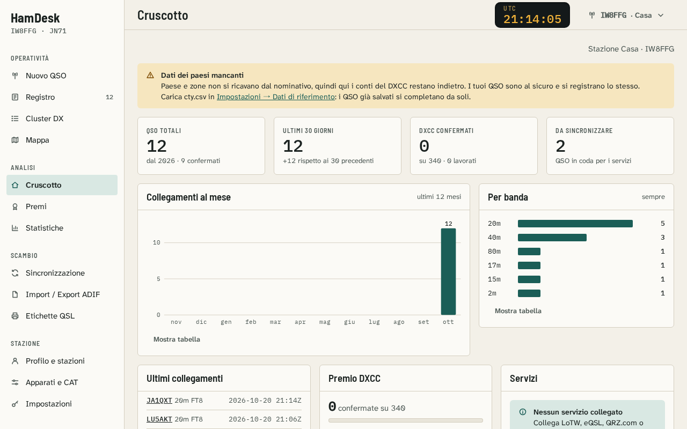
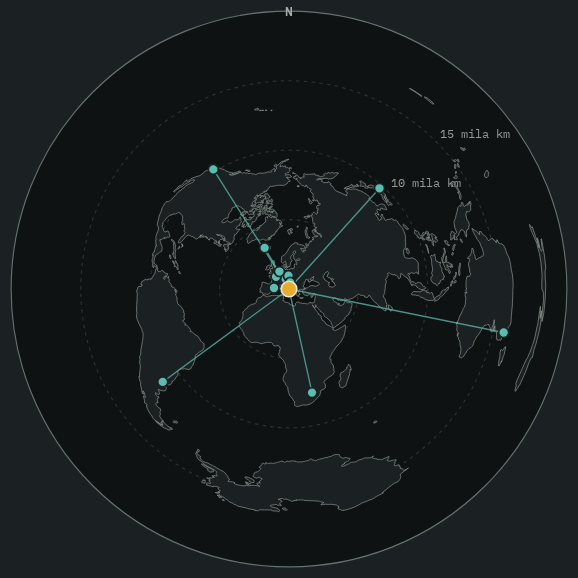
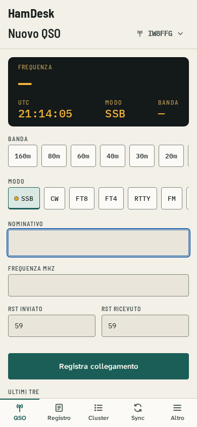

<p align="center">
  
</p>

<h3 align="center">Il registro di stazione per radioamatori, sul tuo computer.</h3>

<p align="center">
  HamDesk è un registro di stazione in italiano che si installa in locale su Windows: registri i collegamenti da tastiera, tieni d'occhio DXCC e award, e sincronizzi LoTW, eQSL, QRZ.com e Club Log. I dati restano tuoi, sul tuo computer.
</p>

<p align="center">
  <a href="https://github.com/iw8ffg/hamdesk-releases/releases/latest"><strong>⬇ Scarica l'ultima versione</strong></a>
  &nbsp;·&nbsp;
  <a href="#installazione"><strong>Installazione</strong></a>
  &nbsp;·&nbsp;
  <a href="https://github.com/iw8ffg/hamdesk-releases/issues"><strong>Segnala un problema</strong></a>
</p>

---

## Schermate

<table>
  <tr>
    <td align="center" width="50%">
      <br>
      <sub><b>Nuovo QSO</b> · tema Carta</sub>
    </td>
    <td align="center" width="50%">
      <br>
      <sub><b>Registro</b> · tema Notte</sub>
    </td>
  </tr>
  <tr>
    <td align="center">
      <br>
      <sub><b>Cruscotto</b> · tema Carta</sub>
    </td>
    <td align="center">
      <br>
      <sub><b>Mappa</b> · tema Notte</sub>
    </td>
  </tr>
</table>

<p align="center">
  <br>
  <sub>Dal telefono o dal tablet, sulla rete di casa</sub>
</p>

Le immagini usano dati di esempio.

## Cosa fa

- **Registro** veloce da tastiera, orari sempre in UTC, ricerca e filtri, import ed export ADIF, copie di sicurezza automatiche.
- **QSL**: LoTW (tramite TQSL, la chiave privata resta lì), eQSL, QRZ.com e Club Log, con invio automatico e scarico delle conferme. I cinque stati QSL sono sempre scritti, non solo colorati.
- **Dati derivati**: paesi DXCC, zone CQ e ITU, locatori, statistiche, award (DXCC, WAS, WAC, VUCC…), mappa azimutale e classica.
- **In stazione**: Cluster DX con invio di spot e comandi, controllo della radio (CAT), satelliti ed EME, stampa delle etichette QSL in PDF, vista portatile.
- **Temi** Carta e Notte, tutto usabile da tastiera.
- **Database** SQLite (predefinito) o PostgreSQL, scelto in installazione.

## Installazione

1. Dalla pagina dell'[ultima versione](https://github.com/iw8ffg/hamdesk-releases/releases/latest) scarica `HamDesk-Setup-<versione>.exe` e `SHA256SUMS.txt`.
2. **Verifica l'impronta** (consigliato). In PowerShell, nella cartella dei download:
   ```powershell
   Get-FileHash .\HamDesk-Setup-1.0.5.exe -Algorithm SHA256
   Select-String -Path .\SHA256SUMS.txt -Pattern 'HamDesk-Setup'
   ```
   I due valori devono essere uguali.
3. Avvia l'installer. **Non servono permessi di amministratore**: il programma va in `%LOCALAPPDATA%\Programs\HamDesk`, i dati restano separati e non si toccano negli aggiornamenti.
4. Apri HamDesk: il primo avvio ti guida nella scelta del database e nella creazione della stazione.

> **Windows SmartScreen.** Per ora l'installer non è firmato: Windows può mostrare «Windows ha protetto il PC» ed «editore sconosciuto». Dopo aver verificato l'impronta scegli «Ulteriori informazioni», poi «Esegui comunque». Alcuni antivirus possono segnalare per errore il disinstallatore: è un falso positivo dovuto alla mancanza di firma.

**Requisiti**: Windows 10 o 11 a 64 bit. Per LoTW serve [TQSL](https://lotw.arrl.org) installato con il tuo certificato.

## Aggiornamenti

HamDesk controlla da solo, una volta al giorno, se c'è una versione nuova e lo segnala in **Impostazioni → Aggiornamenti** (dalla 1.0.4; il controllo si può spegnere e non invia dati personali). Per aggiornare scarica il nuovo installer ed eseguilo sopra la versione esistente: i dati restano e il database si aggiorna da solo. Prima di aggiornare conviene fare una copia di sicurezza da Impostazioni.

## Servizi QSL in breve

- **Club Log**: la chiave dell'applicazione è già inclusa. In Sincronizzazione collega il tuo account con email, nominativo e una **password applicativa** (su Club Log: Settings → App Passwords), mai la password del sito.
- **LoTW**: HamDesk usa TQSL installato sul tuo computer; nome utente e password LoTW servono solo per scaricare le conferme. La posizione di stazione di TQSL deve corrispondere ai dati dei tuoi QSO (locatore, nominativo).
- **QRZ.com**: serve un abbonamento QRZ.com che includa il logbook via API.
- **eQSL**: utente e password del tuo account eQSL.cc.

## Accesso dal telefono o dal tablet

In **Impostazioni → Sicurezza** puoi accendere l'accesso dalla rete di casa: HamDesk mostra l'indirizzo da aprire e l'impronta del certificato. Il firewall di Windows deve consentirlo (HamDesk te lo dice e può creare la regola); se l'antivirus ha un proprio firewall, va consentito anche lì.

## Problemi e suggerimenti

Apri una [segnalazione](https://github.com/iw8ffg/hamdesk-releases/issues) indicando la versione (Impostazioni → Informazioni) e cosa stavi facendo. Non allegare password, chiavi o file di registro senza averli controllati.

## Licenza

HamDesk è **freeware**: gratuito per uso personale e radioamatoriale, anche in radio club e spedizioni. Puoi ridistribuire l'installer ufficiale così com'è, indicando questa pagina. Il codice sorgente non è distribuito. Il testo completo è nel file [`LICENSE`](LICENSE); i componenti di terzi inclusi conservano le proprie licenze (elenco nel programma, Impostazioni → Informazioni).

I nomi LoTW, eQSL, QRZ.com e Club Log appartengono ai rispettivi titolari; HamDesk non è affiliato a nessuno di essi. Il file dei paesi (Big CTY) è curato da Jim Reisert, AD1C, e usato con il suo consenso.

---

<p align="center"><sub>73 de IW8FFG</sub></p>
